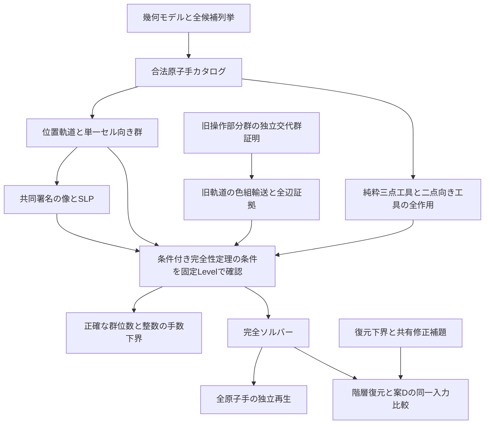

# 内面回転を含むMenger系の研究記録

正式な研究対象は `inner-square`。slice・extension・内面回転を全て含む。
`standard` は過去の結果との比較用。両系の位数・最悪手数下界・スクランブルを混同しない。

## 研究課題

1. 同じセル形状で内面回転を許すと、到達可能状態はどのように変わるか。
2. その全操作群に対する到達可能性判定と、構成的な完全解法を得られるか。
3. 階層的復元と可換相殺は、同一の十分に混ざった入力で何を改善するか。

Level2の内面追加は指数2の拡大だった。しかしLevel3に「軌道は同じで偶奇だけ増える」という
仮説を適用した検査は失敗した。実際には164軌道が116軌道へ合流し、向き自由度も増えた。
この反例を受け、旧不変量の流用を止め、全生成元の軌道・単一セル安定化群・共同準同型像を再計算した。

## 対象と検証の契約

内面候補は一層内の任意部分集合で、外接箱は軸を中心とする正方形。
整数・半整数中心と±90/180度を含む。旧slice・再帰的extension/slab/cell操作も保持する。
任意の多層部分集合・斜め軸は対象外。
全16平面タイプ等の監査が完了しないLevelを、部分的なリング追加で「完全」とは扱わない。

[証明](../proofs/inner-square-completeness.md)は、一般命題と固定Levelの計算条件を分けている。
幾何学的に受理された追加手は厳密整数半径による掃過体分離も確認する。
純粋3点工具の正規閉包、二点向き工具の全作用、共同Z4像のSLPを検証する。
共同像の位数は、別実装の二ビット平面消去でも確認する。

## 再現手順

```sh
# 全候補を平面形状ごとに監査。完了したprofileだけ再利用する。
node --import tsx research/inner-square-expanded/enumerate.ts 2
node --import tsx research/inner-square-expanded/enumerate.ts 3
node --import tsx research/inner-square-expanded/enumerate.ts 4
node --import tsx research/inner-square-expanded/export-catalog.ts 4

# 各Levelで実行（3を4に替えて繰り返す）
node --import tsx research/inner-square-expanded/census.ts 3
node --import tsx research/inner-square-expanded/find-tools.ts 3
node --import tsx research/inner-square-expanded/certify.ts 3
node --import tsx research/inner-square-expanded/independent-image.ts 3
node --import tsx research/inner-square-expanded/transport-audit.ts 3
node --import tsx research/inner-square-expanded/functional.ts 3
node --import tsx research/inner-square-expanded/restoration-check.ts 3
node --import tsx research/inner-square-expanded/bound-check.ts 3
node --import tsx research/inner-square-expanded/shared-check.ts 3
# Level4の大軌道の全色組辺
node --import tsx research/inner-square-expanded/factored-audit.ts 4

# 同じ入力で完全方式、案D、適応的階層復元を比較
node --import tsx research/inner-square-expanded/benchmark.ts 3 1000 101
```

`profile`に`complete:false`がある場合は計算中か中断状態であり、エクスポート不可。
列挙上限に達しても部分結果を正式カタログにしない。
ソルバーは履歴を読まず現在状態のみを受け取る。実験の履歴ハッシュは再現用に別記録する。

## 比較方法

各試行の最初の3手でslice・extension・innerを必ず一つずつ使い、残りは族を等確率、
その族の合法原子手を等確率で選ぶ。180度のみ合法の対象もプールに含む。
これは全生成元を含む宣言済み分布であり、群上の一様標本ではない。
長さ100/1000、seedを固定して部品の位置移動数・族別手数を記録する。

比較は、共同署名の完全方式、同じ解答への案D相殺、案Dを含む適応的階層復元。
復元方式がDだけと同じ解答なら、構造利用による追加改善とは数えない。
深さ3では到達不能と下界で分かる場合、復元探索を省略する。
完全方式・復元方式の実行順はseedの偶奇で入れ替える。
ライブラリ構築・実エンジン照合・疎な再生など、計時に含む処理を記録する。

seed1〜20は開発・実装修正に使用した。主要な比較は別のseed101〜110（Level2/3）、101〜103（Level4）で行う。正式な事前登録ではなく、集計前に固定した保留seedの比較である。
主要な[集計結果](inner-square-results.md)とCSV/JSONを合わせて確認する。
手数は決定的な出力、実行時間は同一機でも他の実験・GC・初回実行の影響を受ける。
同時実行中の時間から統計的な速度優位を主張しない。
データは `research/inner-square-expanded/out/bench-*.json` に入力ハッシュと共に保存する。

大きい解答は全原子手の疎な整数再生で確認する。
小さい代表例は実エンジンでも逐次再生する。二つの検証方法を一つの表現で混同しない。

## 一般化と新しい構造を使った効果

旧軌道の独立な交代群を内部輸送に使い、新軌道全体の位置対ではなく旧軌道の色組を探索する。
Level4最大軌道の25,248²状態を407²状態へ減らし、各商グラフ辺の実現語と距離減少を全件検査する。
旧群を利用する点は、単なるビット配列化や可換相殺とは区別できる構造上の工夫である。
素朴な新軌道の二点BFSはLevel4でJavaScript Mapの最大サイズに到達した。開発時の失敗として保存する。

同じセットアップを使う独立な交換子の支持条件も証明・実装した。
Level3/4とも、8点に作用する四修正を16→10原子手へ共有できる。
ただし、深い入力の還元全体へこの共有語を自動配置する実装はまだない。
一般nについて証明したものは、平面形状の2^n還元、復元距離のD/8^n下界、支持条件付き共有補題、条件付き完全性定理である。
全nで工具が存在するという無条件の証明は残る。

## ISEFに向けて

主要な成果候補は、幾何的な操作集合を確定した際に生じる軌道合流・向き自由度の変化、
共同準同型による完全解法と正確な群位数、整数計算による最悪手数の下界である。
浅い設計入力を短く解いたことだけを効率の成果にしない。
「研究課題・方法・実行と解釈・創造性・発表」の観点で、定義・証拠・限界を説明できる資料を作る。
[公式審査基準](https://www.societyforscience.org/isef/grand-award/criteria/)

Menger形状とRubik型操作を結び付ける発想自体を、新規と断言しない。
以下の先行研究のモデルとの差を調べる必要がある。

- [On Rubik's Cube, KTH（§5.6）](https://people.kth.se/~boij/kandexjobbVT11/Material/rubikscube.pdf)：検索キャッシュでMenger高次キューブへの一般化の節を確認。原本URLは取得時404であり、原本の再取得と精読が必要。
- [Bizek, The Rubik's-Cube Design Problem, Bridges 2000](https://archive.bridgesmathart.org/2000/bridges2000-347.html)：Rubikキューブの集合によるフラクタル模様の設計。穴を持つ物理操作群を扱う本モデルとの違いを明記する。
- [Demaineほか, Algorithms for Solving Rubik's Cubes](https://arxiv.org/abs/1106.5736)：通常の大型キューブの一括処理。本モデルへ計算量をそのまま移せない。

ここでの計算結果は、文献上の新規性の確定や大会の評価を保証するものではない。
AI支援で生成・修正したコードと証明案を含む。証明条件、失敗した仮説、独立検査、
学生本人が検算・説明した部分を研究ノートに記録し、発表時の説明可能性を確保する。

## 欠損評価の限界も数値化できる

Level4ではD≤160,000、K=4,096なので、単純なceil(D/K)下界が出せる値は高々40である。
一方、位置群の剰余類を数えると、最悪の葉ブロック復元距離は71,785手以上となる。
この大きな差は、局所的な剛体一致数だけでは全体の組合せ的困難さを十分に捉えられないことを示す。
欠損値は深さ付き探索を省略する証明に役立つが、長距離の復元探索には別の下界・工具構造が必要になる。

## 証明の依存関係



工具の発見予算やランダム試行の成功を完全性の証明へ使わない。
旧群の証明は新群の試行結果に依存しない。色組輸送も、旧群内での輸送と新手の証拠辺を分けて検査する。
