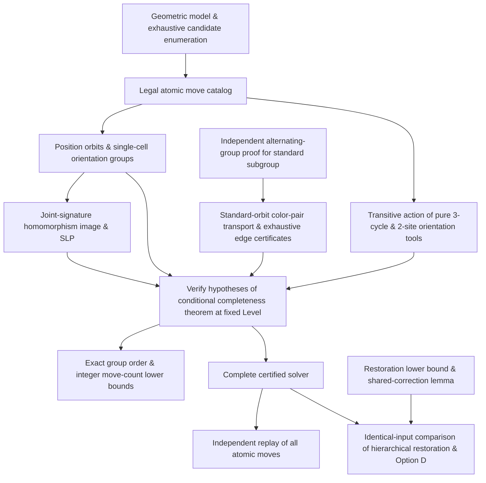

# Research Notes on the Menger System with Inner-Square Rotations

The primary move system under study is `inner-square`, which includes all `slice`, `extension`, and inner-square rotations.
The `standard` system is retained for comparison with earlier results. Do not conflate the group orders, worst-case move lower bounds, or scramble distributions of the two systems.

## Research Questions

1. When inner-square rotations are permitted on the same cell geometry, how does the set of reachable states change?
2. Can we obtain a reachability criterion and a constructive, complete solving algorithm for the full move group?
3. What do hierarchical restoration and commutative cancellation improve when evaluated on identical, thoroughly mixed inputs?

At Level 2, adding inner-square rotations yielded an index-2 extension. However, testing the hypothesis at Level 3 that "position orbits remain unchanged and only parity rank increases" failed: in reality, 164 position orbits merged into 116 orbits, and single-cell orientation freedoms also expanded.
In response to this counterexample, we stopped reusing invariants from the `standard` system and recomputed all position orbits, single-cell stabilizers, and joint homomorphism images from scratch across the full generator set.

## Scope and Verification Contract

An inner-square candidate is an arbitrary subset of cells within a single layer whose bounding box is a square centered on the rotation axis.
Both integer and half-integer centers with angles $\pm 90^\circ$ and $180^\circ$ are included. Existing `slice` and recursive `extension`/slab/cell moves are preserved.
Arbitrary multi-layer subsets and non-axis-aligned (diagonal) rotation axes are out of scope.
A Level whose audit across all 16 plane types (or equivalent layer classes) is incomplete is never treated as "complete" by merely adding a partial set of rings.

The [completeness proof](../proofs/inner-square-completeness.md) separates general propositions from computational certificates at fixed Levels.
Every geometrically accepted additional move is also verified for swept-volume clearance using exact integer radii.
We verify the normal closure of pure 3-cycle tools, the transitive action of two-site orientation tools, and the straight-line program (SLP) for the joint $\mathbf{Z}_4$ homomorphism image.
The order of the joint image is cross-checked via an independent two-bit plane-elimination implementation.

## Reproduction Commands

```sh
# Audit all candidates by plane profile. Reuse only profiles marked complete.
node --import tsx research/inner-square-expanded/enumerate.ts 2
node --import tsx research/inner-square-expanded/enumerate.ts 3
node --import tsx research/inner-square-expanded/enumerate.ts 4
node --import tsx research/inner-square-expanded/export-catalog.ts 4

# Run at each Level (replace 3 with 4 to repeat)
node --import tsx research/inner-square-expanded/census.ts 3
node --import tsx research/inner-square-expanded/find-tools.ts 3
node --import tsx research/inner-square-expanded/certify.ts 3
node --import tsx research/inner-square-expanded/independent-image.ts 3
node --import tsx research/inner-square-expanded/transport-audit.ts 3
node --import tsx research/inner-square-expanded/functional.ts 3
node --import tsx research/inner-square-expanded/restoration-check.ts 3
node --import tsx research/inner-square-expanded/bound-check.ts 3
node --import tsx research/inner-square-expanded/shared-check.ts 3
# All color-pair edges for large orbits at Level 4
node --import tsx research/inner-square-expanded/factored-audit.ts 4

# Compare certified solver, Option D, and adaptive hierarchical restoration on identical inputs
node --import tsx research/inner-square-expanded/benchmark.ts 3 1000 101
```

If any `profile` contains `complete:false`, enumeration is still running or was interrupted and cannot be exported.
Reaching an enumeration cutoff never promotes partial results into the official catalog.
Solvers receive only the current puzzle state and do not read scramble history. Scramble history hashes are recorded separately for benchmark reproducibility.

## Comparison Methodology

In each trial, the first 3 moves use one `slice`, one `extension`, and one `inner` move, and each subsequent move selects a family uniformly at random and then a legal atomic move uniformly within that family. Targets that are legal only at $180^\circ$ are included in the pool.
This is a declared scramble distribution covering all generator families, not a uniform sample over the group.
With fixed scramble lengths of 100 and 1,000 and fixed seeds, we record the number of displaced cubies and move counts per family.

The comparison evaluates the joint-signature certified solver, Option D commutative cancellation applied to that exact solution, and adaptive hierarchical restoration (which includes Option D).
Whenever the restoration method produces the exact same output as Option D alone, it is not counted as an additional structural improvement.
When the lower bound proves that restoration is unreachable within depth 3, the restoration search is skipped.
The execution order of the certified solver and restoration solver alternates according to seed parity.
All operations included in wall-clock timing—such as library construction, real-engine checks, and sparse replay—are explicitly logged.

Seeds 1–20 were used during development and debugging. Primary benchmark comparisons use held-out seeds 101–110 (Levels 2 and 3) and 101–103 (Level 4). While not a formal external preregistration, these held-out seeds were fixed prior to aggregation.
Inspect the primary [aggregated results](inner-square-results.md) alongside the raw CSV/JSON outputs.
Move counts are deterministic outputs, whereas execution times on the same machine are affected by concurrent processes, garbage collection, and cold-start caching.
We make no claims of statistical runtime superiority from concurrent benchmark timings.
Benchmark records are saved together with input state hashes in `research/inner-square-expanded/out/bench-*.json`.

Large solutions are verified by sparse integer replay of every atomic move.
Smaller representative solutions are also replayed step-by-step on the full engine. These two verification modes are kept distinct and never conflated under a single label.

## Generalization and Impact of Exploiting Group Structure

By exploiting the independent alternating groups of the `standard` orbits for internal transport, we search over ordered color-pairs of `standard` sub-orbits rather than ordered site-pairs across the entire merged `inner-square` orbit.
For the largest orbit at Level 4, this reduces the state space from $25,248^2$ to $407^2$ states, allowing exhaustive verification of the realizing word and distance decrease across every quotient-graph edge.
Leveraging the subgroup structure of the `standard` move system is a mathematical reduction distinct from low-level bit-packing or local commutative cancellation.
A naive ordered-pair BFS over the merged orbit at Level 4 exceeded the maximum size of a JavaScript `Map`; this negative result is preserved in the research record.

We also proved and implemented support-disjointness conditions for independent commutators sharing a common setup word.
At both Levels 3 and 4, four corrections acting on 8 sites can share a single setup, reducing 16 atomic moves to 10.
However, automatic scheduling of these shared-setup words across full reductions of deep scrambles is not yet implemented.
For general Level $n$, our proved results comprise the $2^n$ reduction of distinct layer profiles, the $D / 8^n$ lower bound on block-restoration distance, the shared-correction lemma under support conditions, and the conditional completeness theorem.
An unconditional proof that pure tools exist for all $n$ remains an open problem.

## Toward ISEF

The primary contributions are: the discovery of orbit merging and expanded orientation freedom once the geometric move set is completed; the exact group order and constructive complete solver via the joint homomorphism; and the worst-case move lower bounds established via exact integer arithmetic.
Solving shallow, hand-crafted scrambles in few moves is not presented as a general efficiency breakthrough.
Documentation is structured around the ISEF judging criteria—Research Question, Design and Methodology, Execution, Creativity, and Presentation—to clearly communicate definitions, certified evidence, and limitations.
[Official ISEF Grand Award Judging Criteria](https://www.societyforscience.org/isef/grand-award/criteria/)

We do not claim that the general idea of combining Menger sponge geometry with Rubik-style twists is novel in itself.
Differences between our exact physical model and prior literature must be stated clearly:

- [On Rubik's Cube, KTH (§5.6)](https://people.kth.se/~boij/kandexjobbVT11/Material/rubikscube.pdf): Search cache confirms a section discussing generalizations to higher-order Menger cubes. The original URL returned 404 at retrieval time; obtaining and closely reading the original text remains necessary.
- [Bizek, The Rubik's-Cube Design Problem, Bridges 2000](https://archive.bridgesmathart.org/2000/bridges2000-347.html): Designs fractal patterns out of assemblies of standard Rubik's Cubes. We explicitly distinguish that artistic/combinatorial assembly problem from our physical group model of collision-free rotations on a single perforated fractal cube.
- [Demaine et al., Algorithms for Solving Rubik's Cubes](https://arxiv.org/abs/1106.5736): Batch solving for standard $N \times N \times N$ Rubik's Cubes. Its asymptotic bounds do not transfer directly to perforated Menger sponge move groups.

The computational certificates here do not guarantee literature novelty or competition outcomes.
This project includes code and proof drafts generated and refined with AI assistance. All proof hypotheses, falsified conjectures, independent verification scripts, and components personally derived, checked, and explained by the student are logged in the research notes to ensure full explainability during presentation.

## Quantifying the Limits of the Defect Heuristic

At Level 4, $D \le 160,000$ and the maximum single-move block-defect change is $K = 4,096$, so the naive $\lceil D / K \rceil$ bound can never exceed 40 moves.
By contrast, counting cosets of the position group proves that worst-case leaf-block restoration requires at least 71,785 moves.
This wide gap demonstrates that local rigid-block match counts alone cannot capture the global combinatorial difficulty of the group.
While the defect lower bound is useful for pruning bounded-depth searches, long-range restoration requires stronger structural lower bounds and macro tools.

## Proof Dependency Graph



Tool-discovery search budgets and random scramble successes are never used as evidence in the completeness proof.
The proof for the `standard` subgroup does not depend on empirical trials in the expanded `inner-square` group. Color-pair transport likewise separates intra-sub-orbit alternating transport from inter-sub-orbit certified bridge edges.
